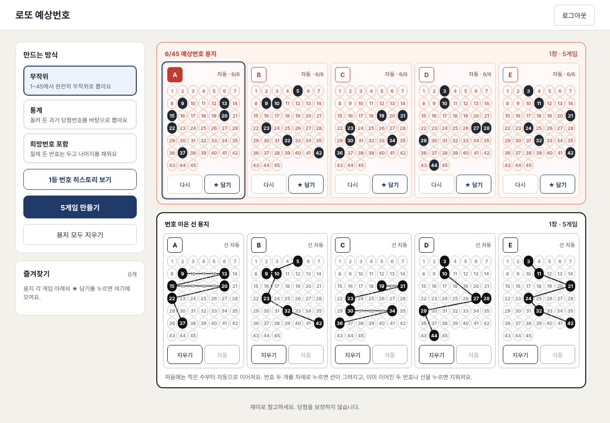

# Web-Lotto

> A small self-hosted web app that generates Korean Lotto 6/45 number picks —
> random, statistics-weighted (hot / cold / mixed) or around your own favorite numbers —
> using past draw results you upload as an Excel file. FastAPI + SQLite, deployed with Docker.

로또 6/45 **예상번호를 만들어 주는 개인용 웹 앱**입니다.
과거 당첨번호 엑셀을 올려 두면 많이 나온 번호·오래 안 나온 번호 같은 통계를 반영해 번호를 뽑고, 마음에 드는 조합은 즐겨찾기에 저장합니다.



> ⚠️ 로또 추첨은 매번 독립적이라 **어떤 방식도 당첨 확률을 높이지 않습니다.** 통계 방식은 번호를 고르는 '취향'일 뿐입니다.

---

## 주요 기능

- **번호 만들기** — 한 번에 여러 게임을 만듭니다.
  - `무작위` — 1~45 중 서로 다른 6개를 고르게 뽑기
  - `통계` — 많이 나온 번호 / 오래 안 나온 번호 / 둘을 섞어서
  - `희망번호` — 내가 칠한 번호는 두고, 나머지 자리를 무작위나 통계로 채우기 (자동·반자동·수동 표시)
- **과거 당첨번호 올리기** — 엑셀(.xlsx) 파일의 머리글이나 숫자 모양을 보고 회차·번호 칸을 스스로 찾아 읽습니다. 확실하지 않으면 틀리게 읽지 않고 오류로 알립니다.
- **즐겨찾기** — 마음에 드는 번호 조합 저장·삭제
- **로그인 보호** — 비밀번호 해시(bcrypt)와 서명된 세션 쿠키로 혼자 쓰는 앱을 보호합니다.

## 기술 스택

| 구분 | 사용 기술 |
|---|---|
| 서버 | Python 3.12 · FastAPI · Uvicorn · Jinja2 |
| 저장소 | SQLite (파일 하나) |
| 보안 | bcrypt · itsdangerous (세션 서명) |
| 엑셀 | openpyxl |
| 배포 | Docker · Docker Compose |

## 빠른 시작

```bash
python -m venv .venv
.venv/bin/pip install -r requirements.txt
cp .env.example .env                        # SECRET_KEY에 긴 임의 문자열 넣기
.venv/bin/python -m app.cli hash-password   # 나온 줄을 .env의 LOGIN_PASSWORD_HASH에 붙여 넣기
docker compose up -d --build
```

기본 설정에서는 `http://127.0.0.1:7682` 로 접속합니다. 외부에 공개할 때는 리버스 프록시(HTTPS) 뒤에 두는 것을 권장합니다.

---

만든 사람: [hunmonkey](https://github.com/hunmonkey)
